<div align="center">

# Bumpgate

### Dependabot says CI is green. Kane CLI checks the app still works, and the bump merges only if it does.

[](https://www.testmuai.com/kane-cli/)
[](action.yml)
[](src/agent.mjs)
[](test/)
[](package.json)
[](package.json)
[](#license)

[**Demo video (2:51)**](https://youtu.be/DokOgngtECc) ·
[**Site**](https://maheswar-sah00.github.io/bumpgate/) ·
[**Live demo PRs**](https://github.com/Maheswar-Sah00/bumpgatedemo/pulls?q=is%3Apr) ·
[**Radar results**](radar/RESULTS.md) ·
[**Backtest**](backtest/RESULTS.md) ·
[**Install**](#install)

<br>

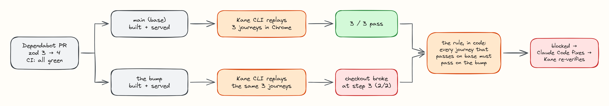

</div>

<br>

On every Dependabot or Renovate PR, Bumpgate builds `main` and the bump side by side and has [Kane CLI](https://www.testmuai.com/kane-cli/) replay your app's critical journeys in a real browser on both. The journeys are plain English, in `.kane/*_test.md`. A plain-code rule decides: **every journey that passes on main must pass on the bump.** If one breaks, Claude Code migrates the code using Kane's evidence and the package's release notes. Code then checks the diff and Kane re-verifies. After three failed tries, the PR goes to a human.

Built for the [Kane CLI Hackathon](https://www.kaneclihack.sh/) by TestMu AI. Agent: **Claude Code** (Codex also supported).

<table>
<tr>
<td align="center" width="25%"><h2>2 / 10</h2>open Dependabot PRs in strangers' repos would ship a <b>blank page</b>. Bumpgate caught both</td>
<td align="center" width="25%"><h2>0 / 4</h2><b>false alarms</b> on bot bumps that were merged and never reverted</td>
<td align="center" width="25%"><h2>3 / 3</h2>live demo PRs merged: 1 green on its own, <b>2 fixed by Claude Code</b> and re-verified by Kane</td>
<td align="center" width="25%"><h2>4 / 4</h2>CI checks passed on a React bump that left the app blank. <b>Kane blocked it at step 1</b></td>
</tr>
</table>

---

## Contents

- [Judges: start here](#judges-start-here)
- [See it work](#see-it-work)
- [How it works](#how-it-works)
- [Architecture](#architecture)
- [Proof on real repos](#proof-on-real-repos)
- [Check our claims](#check-our-claims)
- [Why this only works on Kane CLI](#why-this-only-works-on-kane-cli)
- [Install](#install)
- [Run it yourself](#run-it-yourself)
- [Repository layout](#repository-layout)
- [Honest limits](#honest-limits)

---

## Judges: start here

| What | Where | Time |
|---|---|:---:|
| The demo film: the problem, the gate on real PRs, and what breaks without Kane CLI | [YouTube](https://youtu.be/DokOgngtECc) | 3 min |
| Real Dependabot PRs going through the gate: two blocked, migrated by Claude Code and merged; one green auto-merge | [bumpgatedemo pull requests](https://github.com/Maheswar-Sah00/bumpgatedemo/pulls?q=is%3Apr) | 2 min |
| **Radar:** Bumpgate on 10 *open* Dependabot PRs in other people's repos. 2 blank pages caught, 1 UI drift flagged amber, 7 correctly green. 0 false alarms on 4 bumps that were merged and never reverted | [`radar/RESULTS.md`](radar/RESULTS.md) | 2 min |
| Backtest on real upgrades public repos had to undo: a React PR passed all 4 CI checks, including the deploy to GitHub Pages, and left the app blank. Kane blocked it at step 1 | [`backtest/RESULTS.md`](backtest/RESULTS.md) | 1 min |
| The merge rule, in code (no prompt decides a merge) | [`src/gate.mjs`](src/gate.mjs) and its tests in [`test/gate.test.mjs`](test/gate.test.mjs) | 1 min |
| The guardrails the fix agent cannot get past | [`src/fix.mjs`](src/fix.mjs) (`guardrails`) | 1 min |
| Run it yourself | [below](#run-it-yourself) | 5 min |
| Site with an animated walkthrough | [maheswar-sah00.github.io/bumpgate](https://maheswar-sah00.github.io/bumpgate/) | 1 min |

---

## See it work

### 1 · A bot PR arrives, Bumpgate answers on the PR

Dependabot bumps `zod` from 3 to 4. CI builds fine. Kane replays three journeys on `main` and on the bump: checkout no longer explains what is wrong, because zod 4 removed `error.errors`. Claude Code migrates `src/pages/Checkout.jsx`, Kane re-runs all three journeys, and the PR merges itself.

<p align="center">
  <a href="https://github.com/Maheswar-Sah00/bumpgatedemo/pull/4">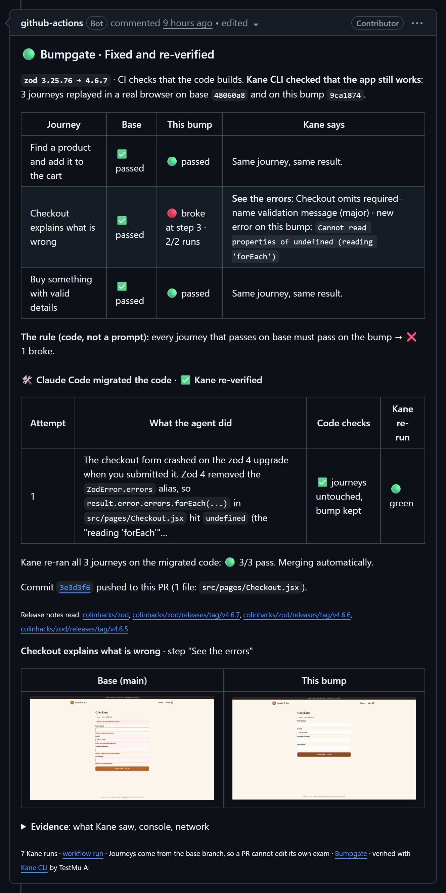</a>
  <br><sub>Bumpgate's comment on <a href="https://github.com/Maheswar-Sah00/bumpgatedemo/pull/4">bumpgatedemo #4</a>: the result for each journey, the rule, what the agent changed, and Kane's screenshots side by side</sub>
</p>

### 2 · What Kane saw: the same journey, base vs bump

<p align="center">
  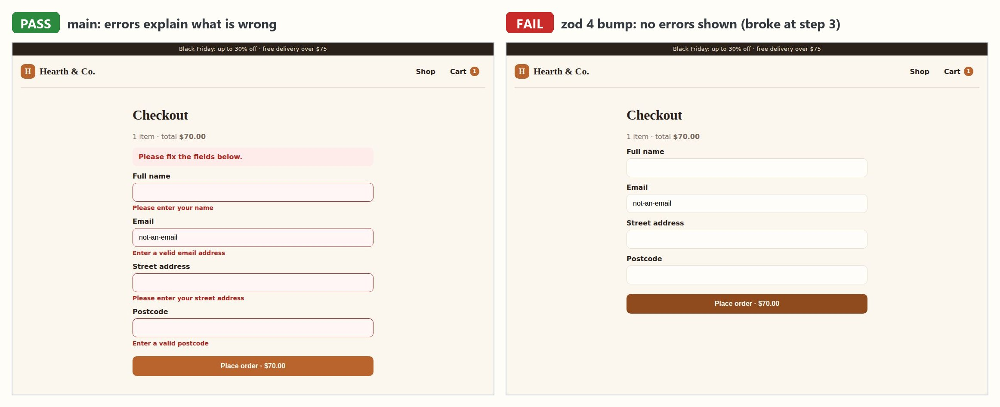
  <br><sub>Kane CLI's own screenshots at the step <i>"See the errors"</i>. CI could not see this: the code compiles and the page renders.</sub>
</p>

### 3 · Safe bumps merge on their own

<table>
<tr>
<td width="50%" valign="top">
<a href="https://github.com/Maheswar-Sah00/bumpgatedemo/pull/5">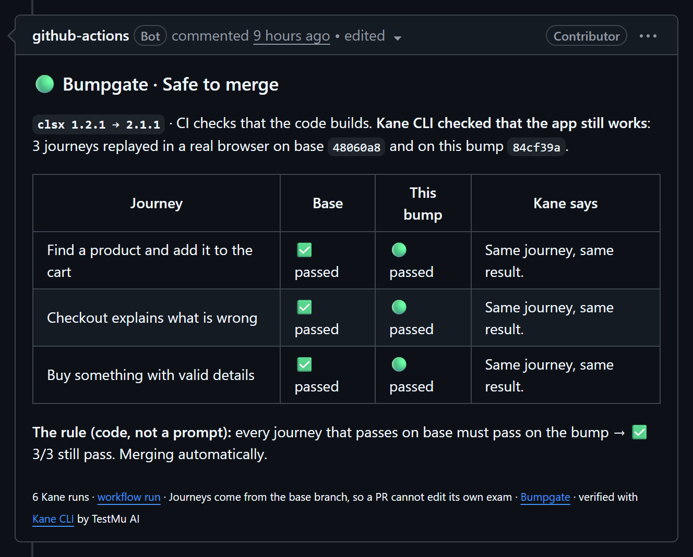</a>
<p align="center"><sub><b>Green:</b> <a href="https://github.com/Maheswar-Sah00/bumpgatedemo/pull/5">#5</a> clsx 1→2. 3/3 still pass, merged in under 2 minutes</sub></p>
</td>
<td width="50%" valign="top">
<a href="https://github.com/Maheswar-Sah00/bumpgatedemo/pulls?q=is%3Apr+is%3Aclosed">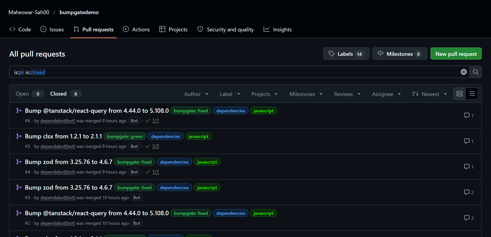</a>
<p align="center"><sub>Every demo PR carries its verdict as a label: <code>bumpgate: green</code>, <code>bumpgate: fixed</code></sub></p>
</td>
</tr>
</table>

<details>
<summary><b>The demo app and the site</b></summary>
<br>
<table>
<tr>
<td width="50%">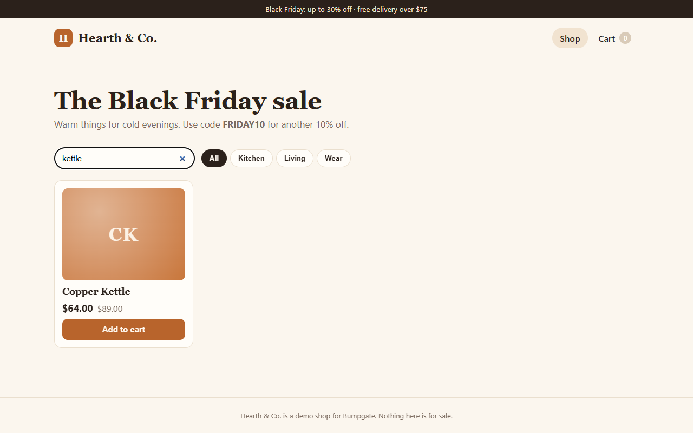<p align="center"><sub><a href="https://github.com/Maheswar-Sah00/bumpgatedemo">bumpgatedemo</a>: a React + Vite shop with real zod, react-query and clsx bumps</sub></p></td>
<td width="50%">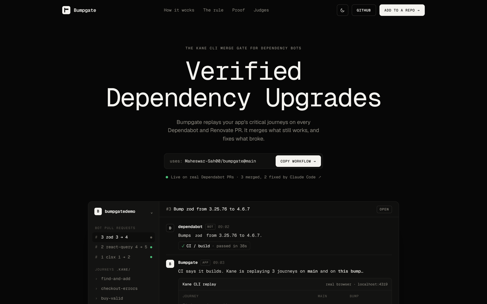<p align="center"><sub><a href="https://maheswar-sah00.github.io/bumpgate/">The site</a>, with an animated walkthrough of a gated PR</sub></p></td>
</tr>
</table>
</details>

---

## How it works

<p align="center">
  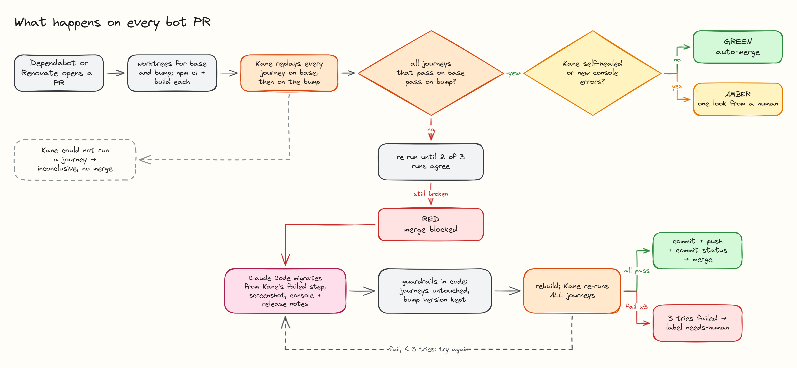
</p>

### The three lights

| Light | Meaning | Action |
|:---:|---|---|
| 🟢 **green** | Every journey that passes on main passes on the bump, with no heal and no new console errors | auto-merge |
| 🟡 **amber** | Passes, but Kane had to self-heal a step, or new console errors or failed requests appeared | one look from a maintainer |
| 🔴 **red** | A journey that passes on main breaks on the bump | blocked → Claude Code migrates → Kane re-verifies → `needs-human` after 3 tries |

### Fail-closed rules

> [!IMPORTANT]
> - If Kane can't run a journey, **nothing merges** (inconclusive).
> - A journey already broken on main **can't block** a bump.
> - Runs that disagree are repeated until **two of three agree**.
> - Journeys and config are always read from the **base** branch, so a PR can't edit its own exam.
> - The fix agent may not touch the journeys or undo the bump. [`src/fix.mjs`](src/fix.mjs) checks this in code, not in a prompt.

### Journeys for code Bumpgate has never seen

<p align="center">
  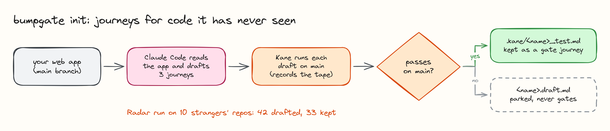
</p>

```bash
npx github:Maheswar-Sah00/bumpgate init --agent claude
```

A journey earns its place only by passing on `main` first, so a bad draft can never block a bump.

---

## Architecture

<p align="center">
  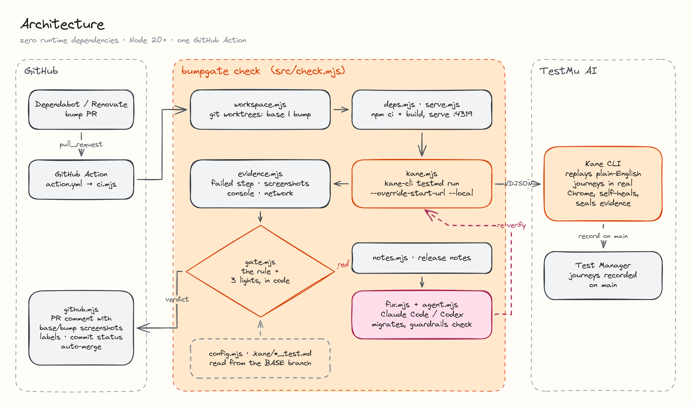
</p>

```
bot PR ─▶ worktrees: base │ bump ─▶ npm ci + build each ─▶ serve on :4319, one side at a time
      ─▶ kane-cli testmd run <journey> --override-start-url --local --agent  (base, then bump)
      ─▶ NDJSON + sealed evidence pack ─▶ gate.mjs: the rule ─▶ 🟢 merge │ 🟡 review │ 🔴 fix loop
fix loop: task = Kane's failed step + screenshot + new console errors + release notes (CHANGELOG / GitHub releases)
      ─▶ Claude Code edits ─▶ guardrails (journeys untouched, bump kept) ─▶ rebuild ─▶ Kane re-runs all journeys
      ─▶ green: commit + push + auto-merge │ still red after 3: label needs-human
```

| File | Job |
|---|---|
| [`src/gate.mjs`](src/gate.mjs) | The rule, a majority vote over re-runs, the three lights |
| [`src/kane.mjs`](src/kane.mjs) | Runs `kane-cli testmd run`, parses its NDJSON stream, isolates each run's recordings |
| [`src/evidence.mjs`](src/evidence.mjs) | Reads the failed step, screenshots, console and network from the sealed `.evidence` pack |
| [`src/check.mjs`](src/check.mjs) | The base vs bump session: worktrees, builds, replays, confirmation runs |
| [`src/workspace.mjs`](src/workspace.mjs), [`src/deps.mjs`](src/deps.mjs), [`src/serve.mjs`](src/serve.mjs) | Git worktrees, install and build detection, static or command servers |
| [`src/fix.mjs`](src/fix.mjs), [`src/agent.mjs`](src/agent.mjs) | The closed loop and its code-enforced guardrails (Claude Code or Codex) |
| [`src/notes.mjs`](src/notes.mjs) | Release notes between the two versions, with the major `x.0.0` notes first |
| [`src/init.mjs`](src/init.mjs) | Drafts journeys and keeps only the ones Kane passes on main |
| [`src/ci.mjs`](src/ci.mjs), [`src/github.mjs`](src/github.mjs), [`action.yml`](action.yml) | The GitHub Action: comment, labels, commit status, evidence branch, auto-merge |

Zero runtime dependencies. `npm test` runs 53 unit tests and an offline end-to-end test of the orchestration. In that test, [`test/e2e/stub-kane.mjs`](test/e2e/stub-kane.mjs) stands in for `kane-cli`. Every verdict in this README comes from real Kane runs.

---

## Proof on real repos

### Radar: open Dependabot PRs in other people's repos

We ran `bumpgate init` and then `check` on 10 open Dependabot PRs in public repos we don't own. In [wfh45678/radar](https://github.com/wfh45678/radar) (1.6k★), [PR #112](https://github.com/wfh45678/radar/pull/112) bumps `react` to 19 but leaves `react-dom` on 18. If the install is forced, the login page ships blank.

<p align="center">
  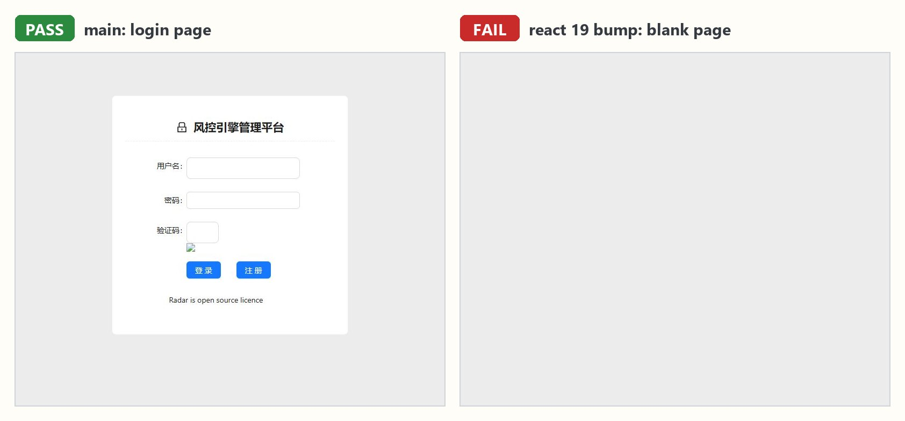
  <br><sub>Kane CLI, journey <i>"login form validation"</i>, from <a href="radar/cases/radar-react/">radar/cases/radar-react</a>. The PR's own CI is red from an npm ERESOLVE conflict, so the claim is "a forced install ships a blank page", not "CI missed it".</sub>
</p>

| Result | Count |
|---|:---:|
| 🔴 blank page caught | **2** |
| 🟡 UI moved but works (MUI 7→9) | **1** |
| 🟢 correctly green (incl. ntfy, 35k★) | **7** |
| False alarms on 4 never-reverted controls | **0** |
| Journeys drafted by `init` / kept after passing on main | **42 / 33** |

Full table: [`radar/RESULTS.md`](radar/RESULTS.md).

### Backtest: a bump a public repo had to revert

[anis-mondal/tic-tac-toe #36](https://github.com/anis-mondal/tic-tac-toe/pull/36) moved `react` to 19.3.0 and left `react-dom` behind. All 4 CI checks passed, including the deploy to GitHub Pages, and the repo reverted it later. Kane fails it at step 1 on 2 of 2 journeys.

<p align="center">
  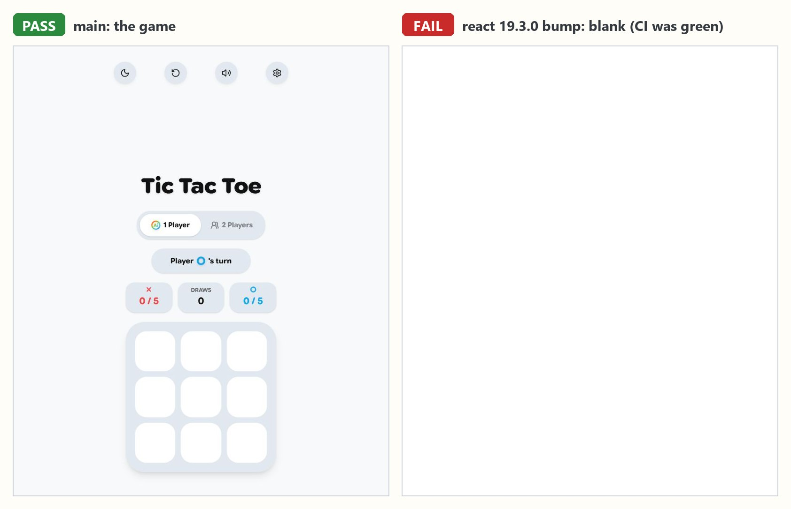
  <br><sub>Details: <a href="backtest/RESULTS.md">backtest/RESULTS.md</a></sub>
</p>

---

## Check our claims

Every number on this page and on the site comes from a real Kane CLI run. Here is where to check each one.

| Claim | Evidence | Check it yourself |
|---|---|---|
| zod 3→4 broke the demo shop's checkout (`error.errors` is gone in zod 4); Claude Code migrated it and Kane re-verified 3/3 | [bumpgatedemo #4](https://github.com/Maheswar-Sah00/bumpgatedemo/pull/4): Bumpgate's comment with the base and bump screenshots, the fix commit and its commit status | `bumpgate check --base main --head origin/dependabot/npm_and_yarn/zod-4.6.7` in the demo repo |
| react-query 4→5 blanked the whole shop; migrated and re-verified | [bumpgatedemo #6](https://github.com/Maheswar-Sah00/bumpgatedemo/pull/6) | same, on the react-query branch |
| A safe bump merges itself | [bumpgatedemo #5](https://github.com/Maheswar-Sah00/bumpgatedemo/pull/5) (clsx 1→2, green, auto-merged) | |
| An open react 19 PR in [wfh45678/radar](https://github.com/wfh45678/radar) (1.6k★) ships a blank login page | [radar/cases/radar-react](radar/cases/radar-react/): the journeys `init` wrote, base and bump screenshots, the PR comment Bumpgate would post | Check out [PR #112](https://github.com/wfh45678/radar/pull/112), `cd frontend && npm ci --legacy-peer-deps && npm run build`, open `dist/`: blank page, `ReactCurrentBatchConfig` in the console |
| A UI-kit major (MUI 7→9) moved the UI under a journey without breaking it: amber, not red | [radar/cases/szakal-2-material](radar/cases/szakal-2-material/) | [szakal-2 #503](https://github.com/AeTher97/szakal-2/pull/503) |
| 0 false alarms on 4 bumps that were merged and never reverted | [Controls table](radar/RESULTS.md#controls-bot-bumps-that-were-merged-and-never-reverted) | Each control links to its merged PR |
| `bumpgate init` writes journeys for code it has never seen: 42 drafted, 33 kept | [radar/cases/*/journeys](radar/cases/) (parked drafts are `*.draft.md`) | `npx github:Maheswar-Sah00/bumpgate init --agent claude` in any web app |
| A React 19.3.0 bump passed all 4 CI checks and left the app blank (backtest) | [backtest/RESULTS.md](backtest/RESULTS.md) with both screenshots | [tic-tac-toe #36](https://github.com/anis-mondal/tic-tac-toe/pull/36) and its revert |
| No prompt decides a merge | [`src/gate.mjs`](src/gate.mjs), 53 unit tests in [`test/`](test/) | `npm test` |

> [!NOTE]
> Kane's raw evidence packs and recordings are not published, because they contain the Kane account's identifiers. Screenshots, journeys, verdicts and PR comments are published.

---

## Why this only works on Kane CLI

| Kane CLI feature | What Bumpgate does with it |
|---|---|
| **Plain-English journeys** | A UI-kit major renames classes and wraps buttons. A recorded selector script breaks even when the shop works, so teams skip it on bot PRs. A Kane journey ("click Place order, verify the errors are shown") fails on broken behaviour, not on new markup. |
| **`testmd run --override-start-url <PR build> --local`** | Replays the journeys recorded on main against each PR build on localhost. It never writes back to Test Manager, so a heal on the bump can't rewrite main's recording. |
| **Self-heal reporting** (`test_md_adaptive_heal`) | A bump that passes only after a heal gets the **amber** light: it works, but the UI moved. Pass/fail alone can't see that. |
| **Sealed evidence packs** | The fix agent gets the failed step, screenshot, console and network logs. Reviewers get the base and bump screenshots side by side in the PR. Kane's own bug verdict (`test_md_bug_verdict`) lands in the PR comment. Raw packs include the Kane account's email, so they are published only with `publish-packs: true`. |

---

## Install

**1. Add the workflow**

```yaml
# .github/workflows/bumpgate.yml
name: Bumpgate
on:
  pull_request:
    types: [opened, synchronize, reopened]
permissions: { contents: write, pull-requests: write, issues: write, statuses: write }
concurrency: { group: "bumpgate-${{ github.event.pull_request.number }}", cancel-in-progress: true }
jobs:
  gate:
    if: github.event.pull_request.user.login == 'dependabot[bot]' || github.event.pull_request.user.login == 'renovate[bot]'
    runs-on: ubuntu-latest
    steps:
      - uses: actions/checkout@v4
        with: { fetch-depth: 0 }
      - uses: actions/setup-node@v4
        with: { node-version: 22 }
      - uses: Maheswar-Sah00/bumpgate@main
        with:
          lt-username: ${{ secrets.LT_USERNAME }}
          lt-access-key: ${{ secrets.LT_ACCESS_KEY }}
          anthropic-api-key: ${{ secrets.ANTHROPIC_API_KEY }}
```

**2. Add the secrets where Dependabot can read them**

> [!WARNING]
> Dependabot PRs can only read **Dependabot secrets**. Add `LT_USERNAME`, `LT_ACCESS_KEY` and `ANTHROPIC_API_KEY` (or `OPENAI_API_KEY` with `agent: codex`) under *Settings → Secrets → Dependabot*, or run `gh secret set NAME --app dependabot`.

**3. Write your journeys, or let Bumpgate draft them**

```bash
npx github:Maheswar-Sah00/bumpgate init --agent claude  # the agent drafts 3 journeys; only the ones Kane passes on main are kept
```

<details>
<summary><b>Action inputs and outputs</b></summary>

| Input | Default | Meaning |
|---|---|---|
| `lt-username`, `lt-access-key` | required | TestMu AI credentials for Kane CLI |
| `agent` | `claude` | The agent that migrates code when a journey breaks: `claude`, `codex` or `none` |
| `anthropic-api-key` / `openai-api-key` | | Key for the chosen agent |
| `amber` | from config | What a yellow light does: `review`, `merge` or `block` |
| `kane-cli-version` | `0.10.7` | Kane CLI version to install |
| `publish-packs` | `false` | Also publish Kane's raw evidence packs (they include the account email) |
| `force` | `false` | Run on any PR, not only Dependabot and Renovate ones |

| Output | Values |
|---|---|
| `verdict` | `green`, `amber`, `red`, `inconclusive` (after any fix) |
| `state` | `green`, `amber`, `red`, `fixed`, `needs-human`, `inconclusive` |

</details>

<details>
<summary><b>Optional <code>bumpgate.config.json</code></b> (read from the base branch)</summary>

```json
{
  "journeys": ".kane",
  "appDir": "",
  "serve": { "type": "static", "dir": "dist", "spa": true },
  "amber": "review",
  "agent": "claude",
  "maxFixAttempts": 3,
  "kane": { "timeout": 300, "maxSteps": 30, "maxRuns": 24 }
}
```

Install and build commands are detected from the lockfile and `package.json` (Vite, CRA, Next.js, Astro, Angular, SvelteKit). `serve` can also be `{ "type": "cmd", "cmd": "npm start -- --port $PORT" }`.

</details>

---

## Run it yourself

Needs Node 20+, Chrome and `kane-cli` (`npm i -g @testmuai/kane-cli`, then `kane-cli login`).

```bash
git clone https://github.com/Maheswar-Sah00/bumpgatedemo && cd bumpgatedemo
git fetch origin 'refs/heads/dependabot/*:refs/remotes/origin/dependabot/*'
npx github:Maheswar-Sah00/bumpgate check --base main --head origin/dependabot/npm_and_yarn/zod-4.6.7
# add --fix --agent claude (or codex) to watch the migration loop
```

| Command | What it does |
|---|---|
| `bumpgate check` | Base vs bump replay and verdict (add `--fix` for the migration loop) |
| `bumpgate init` | Drafts journeys and keeps only the ones Kane passes on main |
| `bumpgate doctor` | Checks Kane, the login, git and the agents |
| `bumpgate backtest` | Replays a past bump and its revert |
| `bumpgate ci` | What the GitHub Action runs |

The verdict lands in `.bumpgate/verdict.json` and the PR comment in `.bumpgate/comment.md`.

| Exit code | Meaning |
|:---:|---|
| `0` | green, or fixed |
| `10` | amber |
| `1` | red |
| `3` | inconclusive |

---

## Repository layout

```
bumpgate/
├── action.yml            GitHub Action (composite)
├── bin/bumpgate.mjs      CLI entry
├── src/                  gate, kane, evidence, check, fix, agent, notes, init, ci, github, …
├── test/                 53 unit tests + offline e2e with a stub kane-cli
├── radar/                10 open Dependabot PRs in public repos + 4 controls (journeys, shots, comments)
├── backtest/             real bot bumps that repos reverted
├── site/                 the GitHub Pages site
└── docs/
    ├── diagrams/         *.png + editable *.excalidraw sources
    └── screenshots/      README screenshots
```

> [!TIP]
> The diagrams are real Excalidraw scenes. Open any `docs/diagrams/*.excalidraw` at [excalidraw.com](https://excalidraw.com) to edit it.

---

## Honest limits

- Kane runs cost TestMu credits. Replaying a recorded journey is cheap; authoring a new one is not. `kane.maxRuns` caps the runs per PR in code.
- Journeys need the app to run without a private backend or a login wall (or with a seeded preview).
- The fix agent can fail a big major migration. The gate still holds, and the PR goes to a human with the evidence.

## License

MIT
