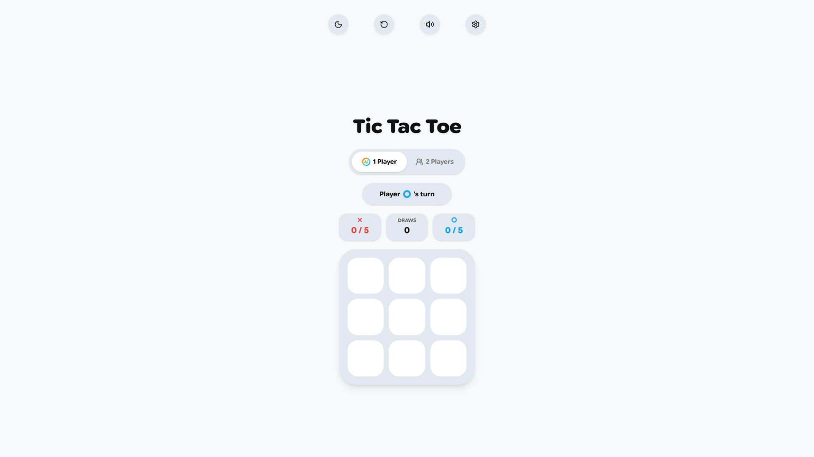

# Backtest: bot upgrades that passed CI and still had to be undone

**Question:** when a Dependabot PR passed CI, got merged, and the maintainer later reverted it, would Bumpgate have stopped it?

**Answer on the cases that can still be run:** Kane blocked the one upgrade that broke the app (React 19.3.0: CI passed on the PR, the merge commit passed all 4 checks including the deploy to GitHub Pages, and the page was blank) and passed the one where no journey broke. Two more reverted upgrades, in repos with no CI, do not even build; Bumpgate blocks those before Kane runs.

| Repo · PR | Upgrade | CI on the PR | Bumpgate | What Kane saw |
|---|---|---|---|---|
| [anis-mondal/tic-tac-toe #36](https://github.com/anis-mondal/tic-tac-toe/pull/36) | react 19.2.8 → 19.3.0 | ✅ CI passed on the PR; the merge commit passed all 4 checks, including the deploy to GitHub Pages | 🔴 **blocked**: 2 of 2 journeys broke (2/2 runs each) | A blank page at the first step. Dependabot raised `react` to 19.3.0 and left `react-dom` at 19.2.8; React refuses mismatched versions ([error #527](https://react.dev/errors/527)). Kane's bug verdict, confirmed: *"React version mismatch leaves game setup page blank"* (major). |
| [Bateas/MeteoMapGal #19](https://github.com/Bateas/MeteoMapGal/pull/19) | @tailwindcss/vite 4.3.1 → 4.3.3 | ✅ passed | 🟢 same: 2 of 2 journeys pass | No broken journey. The revert gives no reason; a Tailwind patch mostly changes styling, which these journeys do not check. |
| [mitvis/website #130](https://github.com/mitvis/website/pull/130) | svelte 5.34.3 → 5.57.0 | no CI | 🔴 blocked at build | The upgrade does not build (mdsvex error). |
| [thorpelawrence/thorpelawrence.github.io #48](https://github.com/thorpelawrence/thorpelawrence.github.io/pull/48) | svelte 3.49.0 → 5.53.5 | no CI | 🔴 blocked at build | Svelte 5 compile error: the `errorMode` option was removed. |

### tic-tac-toe, journey "Two players play a game to a win"

| Before the upgrade (main) | After the upgrade (Dependabot's PR) |
|---|---|
|  |  |

## How it was run

1. Searched GitHub for bot upgrade PRs (Dependabot, Renovate) merged since June 2025 and later reverted: **67**.
2. Kept the plain web apps that build and run with no private backend, login or database: **8**.
3. Built each one before and after the upgrade, with npm install scripts switched off.
4. Wrote the journeys from the **before** version only ([journeys/](journeys/)), before looking at the upgraded app or the revert.
5. Kane CLI 0.10.7 recorded each journey on the before version, replayed it once more there (the recording must be stable), then replayed it on the after version. Bumpgate's own rule decided, with its confirmation runs.

**Excluded, and why:** waffle (the original never loads its config, even when set up as its README says), PvP-moves (the original does not build on Node 22), and two Gatsby cases from web-front (their image library needs install scripts, which stayed off).

**Cost:** about 290 Kane credits for both cases: recording 4 journeys, the replays and the confirmation runs. Replays that pass cost close to nothing.

## What this run fixed in Bumpgate

The first pass marked the Tailwind case amber because of failed requests that were not the upgrade's fault: map tiles the browser cancelled when the map moved, and one call to an outside weather API that failed once. Bumpgate now ignores cancelled image and tile loads, compares requests by shape instead of by tile coordinates, and replays once more when amber comes only from new errors; an error must recur to count. After that fix, the confirmation replay was clean and the case is green.

## Limits

- Two runnable cases is a small sample; most reverted upgrades need a backend, login or database to run at all.
- The journeys were written by us, from the before version only.
- Kane checks what a user can do, not pixels: a pure styling regression can pass.

Results in [results.json](results.json). Kane's raw evidence packs are kept private because they contain the Kane account's email.
