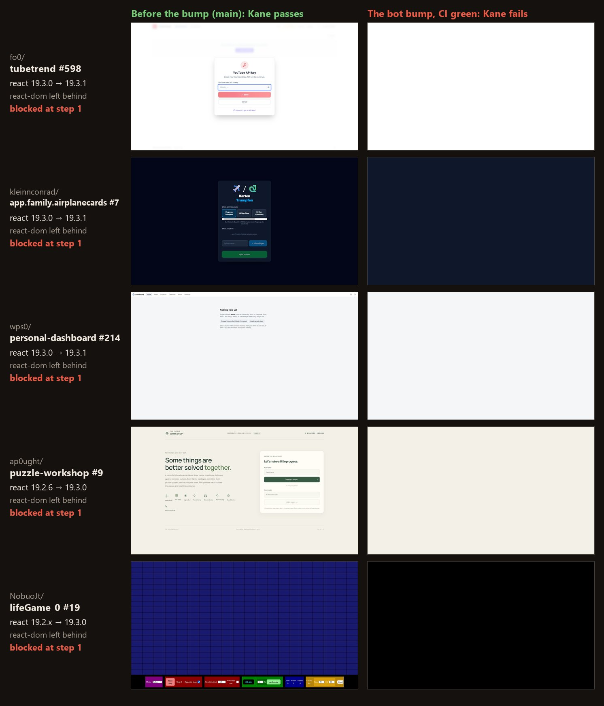

# Backtest 2: five React bumps that passed CI and shipped a blank page

**Kane CLI blocked 5 of 5.** Each is a real Dependabot PR in a public repo. CI passed, the PR merged, the deployed app went blank, and the maintainer had to revert or fix it by hand. With [tic-tac-toe #36](../RESULTS.md) from the first backtest, that is **6 of 6**.

In every case the bot raised `react` and left `react-dom` behind. React refuses to start when the two differ ([error #527](https://react.dev/errors/527)), so the bundle throws before the first render. The type check, lint and build cannot see it, and npm accepts the pair because `react-dom` asks for `^19`. One maintainer wrote in their revert: *"Format check, lint, typecheck and build stay green, which is why the chain did not catch it."*

| Repo · bot PR | Bump | CI | What the maintainer had to do | Kane CLI on the bump |
|---|---|---|---|---|
| [fo0/tubetrend #598](https://github.com/fo0/tubetrend/pull/598) | react 19.3.0 → 19.3.1 | ✅ format, typecheck, lint and build passed on the PR; CodeQL passed on the merge | Revert [#610](https://github.com/fo0/tubetrend/pull/610) | 🔴 1 of 1 journeys broke, 2 of 2 runs. Bug verdict: *"React startup error leaves the application blank"* |
| [kleinnconrad/app.family.airplanecards #7](https://github.com/kleinnconrad/app.family.airplanecards/pull/7) | react 19.3.0 → 19.3.1 | ✅ the merge's build-and-deploy to GitHub Pages passed (the PR itself had no checks) | Revert [3c3023d](https://github.com/kleinnconrad/app.family.airplanecards/commit/3c3023d82e28f2e5fa0f2e7b2b4074540db435dc): *"the deployed page stayed empty"* | 🔴 2 of 2 journeys broke, 2 of 2 runs. *"React version mismatch leaves app blank"* |
| [wps0/personal-dashboard #214](https://github.com/wps0/personal-dashboard/pull/214) | react 19.3.0 → 19.3.1 | ✅ `checks` passed on the PR | [#221 "Fix the blank page"](https://github.com/wps0/personal-dashboard/pull/221) | 🔴 2 of 2 journeys broke, 2 of 2 runs. *"Application renders a blank page after React version error"* |
| [ap0ught/puzzle-workshop #9](https://github.com/ap0ught/puzzle-workshop/pull/9) | react 19.2.6 → 19.3.0 | ✅ PR checks and Vercel preview passed; the merge's check and deploy passed | [#40 "fix production crash"](https://github.com/ap0ught/puzzle-workshop/pull/40) | 🔴 1 of 1 journeys broke, 2 of 2 runs. *"React version mismatch leaves the app blank"* |
| [NobuoJt/lifeGame_0 #19](https://github.com/NobuoJt/lifeGame_0/pull/19) | react 19.2.x → 19.3.0 | ✅ Cloudflare Pages preview passed on the PR; build and deploy passed on the merge | [#22 "Align react and react-dom"](https://github.com/NobuoJt/lifeGame_0/pull/22) | 🔴 2 of 2 journeys broke, 2 of 2 runs. *"React version mismatch leaves the app blank"* |

On every bump, Kane's console log has `Minified React error #527`. On every base, it has none.

## How it was run

1. Searched GitHub for Dependabot React PRs that passed CI, merged, and were later reverted or fixed, where the maintainer named the blank page. Kept the ones that build and run with no backend: **5**.
2. Built each repo at the commit before the bump and at the bump, with npm install scripts off (`--ignore-scripts`).
3. Journeys were written from the version before the bump ([`*/` folders](.), listed in [cases.json](cases.json)). Every repo got the same one-step "The app opens" journey, and three got one more about their own UI (add a player, load the sample data, open the info panel).
4. `bumpgate backtest cases.json --ignore-scripts true` with Kane CLI 0.10.7. Kane recorded each journey on the base and replayed it on the bump. Every failure was confirmed by a second run, as the gate requires. 24 Kane runs, about 650 credits, 67 minutes.

## Limits

- **One bug class.** All five are the same failure: react and react-dom out of step. This shows that Kane catches what CI cannot see, not that it catches every kind of upgrade bug. The demo shop's zod and react-query PRs ([#4](https://github.com/Maheswar-Sah00/bumpgatedemo/pull/4), [#6](https://github.com/Maheswar-Sah00/bumpgatedemo/pull/6)) cover API breaks.
- **Chosen cases.** We searched for this pattern, so 5 of 5 is not a catch rate across all bumps. Our measure of false alarms is in [radar](../../radar/RESULTS.md): 0 on 4 bumps that were merged and never reverted.
- **Small repos.** Hobby and side projects, the kind that auto-merge Dependabot with only a build check.
- **A cheaper check could catch this one class.** A script that compares the `react` and `react-dom` versions would flag all five. Bumpgate's point is that one journey per app catches this and whatever comes next, with no rule written for it.

Kane's raw evidence packs are kept private because they contain the Kane account's email. The screenshots are in [shots/](shots/), and the verdicts and timings are in [results.json](results.json).
